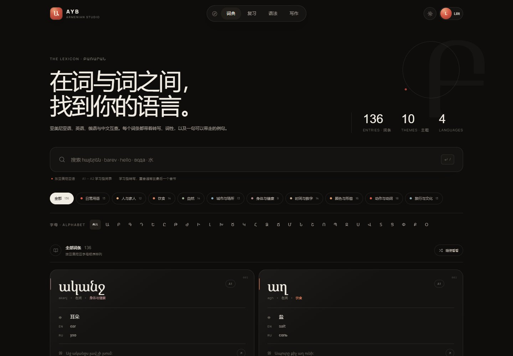
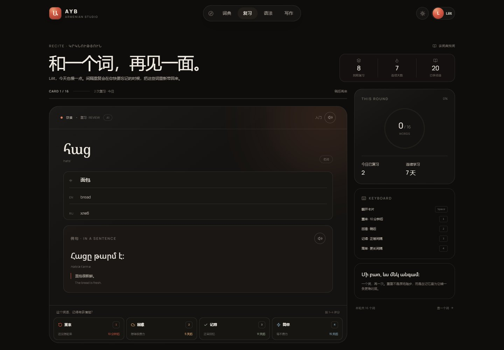
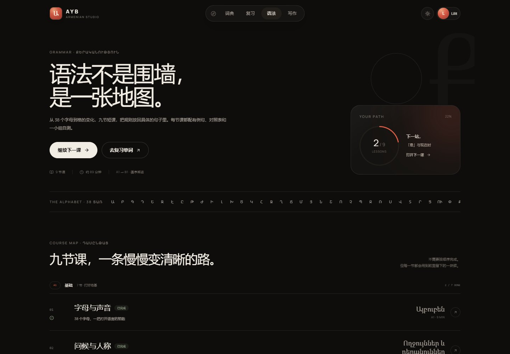
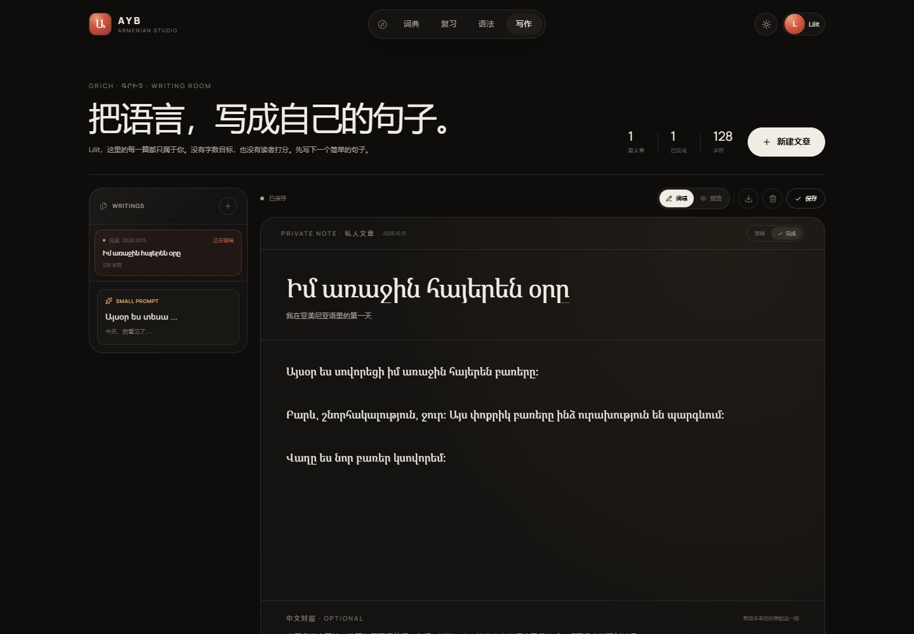

# Այբ · Ayb

> 一间安静的亚美尼亚语学习室。
> Learn Armenian, letter by letter.

Ayb 是一个可运行、可注册、按用户保存进度的亚美尼亚语学习 Web App。视觉语言借鉴 [Innei](https://innei.in/) 的 Shiro 主题：纸感背景、悬浮胶囊导航、大留白、细线框与克制的弹性动效；内容与视觉资产为独立实现，并加入石榴红、杏色与亚美尼亚字母作为品牌语言。

## 预览

| 首页 | 词典 |
| --- | --- |
|  |  |

| 间隔复习 | 语法地图 |
| --- | --- |
|  |  |

| 私人写作室 | 日间主题 |
| --- | --- |
|  |  |

## 功能

- **四语词典**：136 个东亚美尼亚语高频词，提供亚美尼亚语、英语、俄语、中文释义，附学习者友好转写、词性、级别与原创例句。
- **搜索与筛选**：支持四种语言与转写搜索、按首字母筛选、按 10 个主题浏览、随机词条与详情弹窗；快捷键 `/` 聚焦搜索。
- **带例句的背单词**：SM-2 思路改编的四档间隔重复；正面回忆、背面展示释义与例句；新词按主题混合排序；支持词典深链 `?word=jur`。
- **连续学习记录**：按用户记录复习活动、到期词数、已学词数与连续天数；仪表数据会出现在首页与复习页。
- **9 节语法课**：从字母、发音、人称、系词、名词、现在时、疑问否定，到数字形容词、过去将来、格与后置词。包含 38 字母全表、对照表、逐条例句与三题小测。
- **进度保存**：登录后小测通过（≥ 60%）才会写入完成记录；未通过不会误标完成。
- **私人写作室**：创建、编辑、删除文章；草稿 / 完成状态；自动保存与 `Ctrl/⌘ + S`；中文对照；最多 8 个标签；预览；导出 `.txt`。
- **账户系统**：注册、登录、退出、演示账号、HttpOnly 会话、30 天有效；每个用户的数据完全隔离。
- **夜间 / 日间主题**、响应式布局、PWA manifest 与图标、自定义 404。
- **零外部服务**：不需要数据库服务器、邮箱服务或第三方 API；本地 JSON 持久化，开箱即用。

> 页面里带“例句”的复习和语法内容是故意设计的：Ayb 不希望你只记住一个孤立的中文释义。

## 快速开始

要求：**Node.js ≥ 20.9**（推荐 Node 22），npm。

```bash
npm install
npm run dev
```

打开 <http://localhost:3000>。

### 演示账号

非生产模式下会自动生成一个包含复习与语法进度的演示账户：

```text
邮箱：demo@ayb.app
密码：barev1234
```

登录页也提供「一键进入演示空间」。

生产模式默认关闭演示账号。需要临时开启时设置：

```bash
AYB_ENABLE_DEMO=true
```

> 演示账户只会在数据库首次创建时播种。若数据库已经存在，再打开开关不会生成新账户；请使用全新数据目录，或手动删除 `.data`（会清空所有数据）。

## 生产构建

```bash
npm run build
npm start
```

> 项目使用 `output: standalone` 以便容器部署，因此 `next start` 会打印一条建议使用 standalone server 的提示；本地预览仍可正常运行。生产环境推荐使用下方 Docker 方式。

数据默认存放在项目根目录的 `.data/ayb.db.json`。该目录已被 `.gitignore` 排除，**不要提交真实用户数据**。

生产环境使用 HTTPS 时，会话 Cookie 会自动带上 `Secure`；请勿在没有 TLS 的公网地址上直接运行。

```bash
# 备份
cp .data/ayb.db.json backups/ayb-$(date +%F).json
```

### 环境变量

| 变量 | 默认值 | 说明 |
| --- | --- | --- |
| `NEXT_PUBLIC_SITE_URL` | `http://localhost:3000` | 站点公开 URL，用于 metadata、sitemap。 |
| `AYB_DATA_DIR` | `./.data` | JSON 数据库目录。Docker 中建议 `/data`。 |
| `AYB_ENABLE_DEMO` | 非生产为 `true` | 是否播种并允许演示账号。生产建议关闭。 |
| `AYB_TIMEZONE` | 服务器本地时区 | 连续学习日历使用的 IANA 时区，如 `Asia/Shanghai`。 |

复制 `.env.example` 作为起点。该文件不包含任何密钥。

### Docker

```bash
docker compose up -d --build
```

打开 <http://localhost:3000>。数据库存储在命名卷 `ayb_data` 中，容器重建不会丢失。生产部署请：

1. 把 `NEXT_PUBLIC_SITE_URL` 改成真实域名；
2. 用 Nginx/Caddy 配置 HTTPS；
3. 保持 `AYB_ENABLE_DEMO=false`；
4. 定期备份 `ayb_data` 卷；
5. 在反向代理层为登录接口配置共享限流。

### 单实例说明

当前持久化是本地 JSON 文件，适合个人、家庭、小班级或单台 VPS。应用内置了进程内写锁与原子重命名，但没有多实例共享状态。若要横向扩展或做公开社区，请把 `src/lib/server/db.ts` 替换为 Postgres/SQLite（服务端）、将会话与写入锁迁移到数据库，并增加对象存储。

## 内容结构

- **词典**：`136` 个词，10 个主题。
- **语法**：`9` 节课，约 `89` 分钟阅读量，27 道自测题。
- **字体**：Noto Sans Armenian、Noto Serif Armenian、Manrope，均自托管，不依赖 Google Fonts 运行时。
- **内容语言**：中文为主要学习界面；词条保留英语、俄语、中文三种释义，方便多语学习者。

词表与语法说明是面向初学者的种子内容，例句为学习场景原创；**在正式商业发布前，建议请亚美尼亚语母语者做一轮翻译与语用校订**，特别是格变化、动词变位与习惯搭配。

## 设计与技术

- Next.js 15（App Router）+ React 19 + TypeScript
- Tailwind CSS 4 + 自定义 CSS 设计变量
- Motion 弹性动画
- 本地 JSON 持久化 + 进程内写队列 + 原子写入
- scrypt 密码哈希 + 随机 opaque 会话令牌（数据库只保存 SHA-256 摘要）
- Node.js `Intl` 本地日期、时区可配置
- 不依赖任何第三方运行时 API

### 设计要点

- 深色纸张默认主题，可切到奶油色日间主题；
- 导航胶囊、细线分隔、衬线亚美尼亚语标题、衬线写作界面；
- 首页、词典、复习、语法、写作分别有不同的编辑节奏，但共享同一套排版和间距系统；
- 对移动端做专门处理：复习与写作编辑器会隐藏底部 Dock，保留完整操作空间；
- 支持 `prefers-reduced-motion`。

### 安全与隐私

- 密码以 `scrypt` 加盐哈希保存。
- 会话 Cookie 为 `HttpOnly`、`SameSite=Lax`，生产环境 `Secure`；数据库中只保存会话令牌的 SHA-256 摘要。
- 注册、登录、演示登录有基础的内存限流；生产环境建议再加一层反向代理限流。
- 写作与进度 API 全部检查会话和资源归属；已验证跨账户修改返回 404。
- 演示账户在生产默认禁用，且登录接口会额外拒绝演示邮箱。
- 应用的 API 不返回密码哈希；`.data` 永远不会被提交。
- **尚未实现**：邮箱验证、忘记密码、管理员后台、公开文章分享、双因素认证。面向公众上线前请按需补齐，并准备隐私政策与用户协议。

## 常用快捷键

| 页面 | 按键 | 行为 |
| --- | --- | --- |
| 词典 | `/` | 聚焦搜索框 |
| 复习 | `Space` / `Enter` | 翻开卡片 |
| 复习 | `1` `2` `3` `4` | 重来 / 困难 / 记得 / 简单 |
| 写作 | `Ctrl / ⌘ + S` | 立即保存 |

## 项目结构

```text
src/
  app/
    page.tsx                 # 首页 / 学习仪表
    dictionary/              # 四语词典
    review/                  # 间隔复习
    grammar/                 # 语法索引与 [slug] 课程页
    write/                   # 私人写作室
    login/ register/         # 账户
    api/
      auth/                  # 注册 / 登录 / 演示 / 退出
      review/                # 复习队列与评分
      grammar/complete/      # 语法测验提交
      writings/              # 文章 CRUD
      health/                # 容器健康检查
  components/                # 导航、词典、复习、语法、作者工具等 UI
  data/
    dictionary/              # 136 词条，按主题分文件
    grammar/                 # 9 节课程内容
  lib/
    srs.ts                   # 纯函数间隔重复算法
    server/                  # JSON 数据库、会话、限流、业务服务
public/
  fonts/                     # 自托管字体 + OFL 许可文本
  icon-192.png  icon-512.png # PWA 图标
tests/e2e.mjs                # 浏览器端冒烟测试
```

## 测试

应用包含一个 Playwright Core 的浏览器冒烟测试。需要先启动开发服务器，并准备本机 Edge 或 Chrome：

```bash
npm run dev
# 另一个终端
npm run qa
```

如果浏览器不在常见路径，指定：

```bash
AYB_BROWSER_PATH="/path/to/chrome" npm run qa
```

测试会验证词典搜索、演示登录、复习翻面/评分、语法页与测验、写作新建/自动保存/删除。它会修改演示账户的数据，建议在临时数据目录或开发环境中运行。

## 发布清单

- [ ] 设置真实 `NEXT_PUBLIC_SITE_URL` 与 HTTPS
- [ ] 生产环境保持 `AYB_ENABLE_DEMO=false`
- [ ] 为 `.data` / `ayb_data` 配置自动备份
- [ ] 由母语者复核词典与语法内容
- [ ] 补齐邮箱验证、密码重置、隐私政策与用户协议
- [ ] 将本地 JSON 存储换为共享数据库（若需要多实例）
- [ ] 在反向代理层限流与设置安全响应头
- [ ] 选择并添加代码许可证

## 致谢与许可

- 视觉气质致敬 [Innei / Shiro](https://github.com/Innei/Shiro)，未复制其代码或资产。
- 字体来自 Google Fonts：Noto Sans Armenian、Noto Serif Armenian、Manrope；均为 SIL Open Font License 1.1，许可文本在 `public/fonts/`。
- 图标来自 [Lucide](https://lucide.dev/)（ISC）。
- 亚美尼亚语例句与课程说明为 Ayb 项目内容，供学习与演示使用。
- 本项目当前未附加代码开源许可证；若计划公开分发，请自行选择许可协议。
